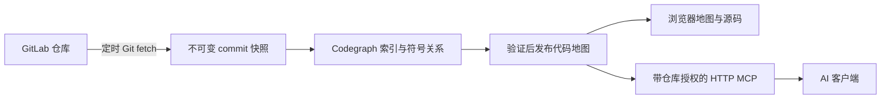

# RepoHarbor · 码港

**简体中文** | [English](README_EN.md)

**代码汇入港，AI 有图可循。**

可自托管的代码地图与 MCP 服务：在网页里连接 GitLab、添加仓库，后台自动同步和建图，
让 AI 从本地地图定位实现、追踪调用，再读取同一版本的源码。

[快速部署](#快速部署) · [页面配置](#页面配置) · [MCP 接入](#mcp-接入) ·
[离线安装](docs/OFFLINE.md) · [运维与升级](docs/OPERATIONS.md) ·
[工具说明](docs/MCP.md) · [参与开发](CONTRIBUTING.md)


> 当前版本 **0.1.3**，支持 **Linux x86_64 / AMD64** Docker 部署，页面为简体中文。
> 建立地图不需要 LLM、embedding、Neo4j 或其他外部数据库。
> GitHub 仓库提供源码和打包脚本；下面的步骤会在本机构建镜像。

## 解决什么问题

当 AI 逐次通过 GitLab API 搜索、打开文件时，需要反复访问远端，也很难直接取得调用、
引用和依赖关系。RepoHarbor 把这些工作提前放在服务器上完成：



日常 AI 查询读取本地已发布快照；GitLab API 用于连接测试、项目发现和分支查询。
同步失败时保留上一个已发布版本。AI 会话中的地图和源码固定在同一 commit。

## 主要能力

| 能力 | 具体行为 |
| --- | --- |
| 网页配置 | 填 GitLab 地址、Token 和具体仓库地址，选择分支，无需手写仓库清单 |
| 自动同步 | 默认每 15 分钟检查更新；commit 未变化时跳过建图，也可立即同步 |
| 完整代码地图 | 基于 Codegraph 3.0.0，提供符号、调用、引用、文件依赖等查询 |
| 浏览器查看 | 文件搜索、依赖图、文件内符号关系、源码行跳转，资源随镜像离线提供 |
| 只读 MCP | Streamable HTTP `/mcp`，19 个工具，查询地图并分页读取源码 |
| 仓库授权 | 每个 AI 读取令牌明确选择仓库；仓库列表、查询和读源码均执行后端权限检查 |
| 版本一致 | 会话第一次使用某个仓库时固定发布 commit；重新连接读取新版本 |
| 单容器部署 | Node.js + Git + Codegraph，一个持久化数据卷，无需单独模型或数据库 |
| 内网安装 | 可在联网机器构建 AMD64 离线包，上传服务器后校验、加载和启动 |

RepoHarbor 的解析和图查询能力来自 [Codegraph](https://github.com/lzehrung/codegraph)。
本项目补充 GitLab 同步、快照发布、网页管理、可视化和按仓库授权的远程 MCP，
不是独立研发的代码解析引擎。

## 快速部署

需要已启动的 Docker Engine、Docker Compose v2 和 Git。
**首次从源码构建需要联网**，用于下载固定的 Node 基础镜像、Debian 软件包和 npm 依赖；
启动后的服务需要能访问你配置的 GitLab。

```bash
git clone https://github.com/zzxCoding/repo-harbor.git
cd repo-harbor
./scripts/start.sh
```

脚本构建 `repo-harbor:0.1.3-amd64`、生成首次管理密码、启动容器并等待健康检查。
打开 **`http://服务器IP:8093`**，使用命令输出中的管理密码登录。
密码也保存在部署目录 `.env`，文件权限为 `0600`。

首次部署时可改变端口和监听地址：

```bash
PORT=18093 BIND_ADDRESS=127.0.0.1 ./scripts/start.sh
```

已有 `.env` 会被保留；后续更改端口应编辑 `.env`，再运行启动脚本。
页面中修改密码后，以新密码为准，`.env` 的首次密码不会覆盖已有密码。
仅运行 Docker 的服务器不需要自行安装 Node.js 或 npm。

### 完全离线服务器

在能联网的机器上生成包含镜像、源码、校验和及部署脚本的安装包：

```bash
./scripts/build-offline.sh
```

将生成的 `delivery/repo-harbor-0.1.3-linux-amd64.tar.gz` 和对应 `.sha256` 上传服务器：

```bash
sha256sum -c repo-harbor-0.1.3-linux-amd64.tar.gz.sha256
tar -xzf repo-harbor-0.1.3-linux-amd64.tar.gz
cd repo-harbor-0.1.3-linux-amd64
./deploy.sh
```

离线安装时不访问 npm 或镜像仓库。构建机需要 Docker 和 Python 3.9+；
ARM 构建机需具备 AMD64 仿真能力。详细步骤见 [离线部署](docs/OFFLINE.md)。

## 页面配置

### 1. 连接 GitLab

打开 **GitLab 连接**，填写服务首页地址、Git 用户名和 Access Token，测试成功后保存。

- Token 需要 **`read_api` + `read_repository`**，并且对应账号有目标项目读取权限。
- 使用个人访问令牌时，Git 用户名通常可填 `oauth2`；凭据用于 HTTP(S) Git 同步。
- 自签证书或企业 CA：在页面填入 PEM 格式 CA 证书，无需关闭 TLS 校验。
- 支持内网 HTTP、HTTPS、自定义端口及 GitLab 子路径部署。
- 本版用 GitLab REST API 发现项目信息，GitLab deploy token 无法替代所需的 API 凭据。

Scope 定义见 [GitLab 官方说明](https://docs.gitlab.com/user/profile/personal_access_tokens/)。

### 2. 添加仓库与分支

打开 **仓库 → 添加仓库**，直接填写具体仓库地址，例如：

```text
https://gitlab.example.internal/team/order-service.git
```

也接受 `team/order-service` 或 `git@host:team/order-service.git`。
SSH 形式只用于识别项目，实际使用 GitLab 返回的 HTTP(S) 地址和 Token 同步；
当前不使用 SSH key。

分支留空时采用项目默认分支，也可填写目标分支。保存后自动开始首次同步和完整建图；
后续可在仓库详情中切换分支。每个仓库配置跟踪一个分支。

### 3. 等待发布并查看地图

仓库详情显示获取代码、文件索引、依赖图、符号关系与验证等阶段。
**文件索引达到 100% 后，仍需完成符号关系分析与验证，才会发布地图。**

“管理设置”可调整同步间隔（1–1440 分钟，默认 15 分钟）和单次建图时间上限
（5–360 分钟，默认 120 分钟）。首次耗时取决于代码规模、语言和 CPU，
无需接入 AI；建图过程中可从日志持续查看进度。

发布后点击 **查看地图**：


地图页面与管理页面使用同一端口，沿用管理员登录。左侧搜索文件，中间查看文件依赖或
当前文件内的符号关系，右侧读取源码；点选符号可跳到相应代码行。
截图使用合成测试仓库。

### 4. 为 AI 创建仓库权限

进入 **AI 接入 → 创建读取令牌**，填写名称并勾选允许访问的仓库。
例如“订单助手”只选订单仓库，“公共组件助手”只选公共组件仓库。


- 不同客户端共用 `/mcp` 地址，各自使用独立 Bearer 令牌。
- `list_repos` 只显示该令牌获准且已启用的仓库；手工传入其他仓库 ID 也不能越权。
- 后续新增仓库不会自动加入旧令牌权限；移除后重新添加同路径仓库需要重新授权。
- 修改权限、启停、轮换或删除令牌后，其原有会话失效，客户端需重新连接。
- 管理密码、GitLab Token 和 AI 读取令牌分别使用；AI 只需要最后一种。

## MCP 接入

客户端需支持 **Streamable HTTP** 和自定义请求头。在客户端配置页填写：

| 配置项 | 值 |
| --- | --- |
| 服务地址 | `http://服务器IP:8093/mcp` 或反向代理后的 HTTPS 地址 |
| 传输方式 | Streamable HTTP |
| 请求头 | `Authorization: Bearer <AI 读取令牌>` |

支持 `mcpServers` 结构的客户端可参考下列配置；具体字段以客户端为准，
也可直接复制“AI 接入”页面为所选令牌生成的接入信息。

```json
{
  "mcpServers": {
    "repo-harbor": {
      "url": "http://服务器IP:8093/mcp",
      "headers": {
        "Authorization": "Bearer <AI 读取令牌>"
      }
    }
  }
}
```

推荐的查询顺序：

1. `list_repos`：选择获准仓库，记录发布 commit。
2. `search` / `workspace_symbols`：用代码关键词或符号名定位实现。
3. `calls` / `refs` / `file_deps`：追踪调用、引用或文件依赖。
4. `get_symbol` / `get_file`：读真实源码，再给出结论与文件行号。

```json
{"name":"list_repos","arguments":{}}
{"name":"search","arguments":{"repo":"<仓库id>","query":"calculatePrice"}}
{"name":"get_file","arguments":{"repo":"<仓库id>","file":"src/pricing.ts","offset":1,"limit":80}}
```

`repo` 接受 `list_repos` 返回的仓库 ID 或准确的 GitLab 项目路径；只有获准且启用的
仓库仅一个时才能省略。`get_file.offset` 从 **1** 开始。
结果附带 `repository/branch/commit/indexedAt` 元数据，重新连接会话可读取新发布版本。
全部工具和限制见 [MCP 说明](docs/MCP.md)。

## 日常管理

在源码部署目录或已解压的离线部署目录运行：

```bash
docker compose --env-file .env -f compose.yml ps
docker compose --env-file .env -f compose.yml logs --tail=200 -f atlas
docker stats --no-stream "$(docker compose --env-file .env -f compose.yml ps -q atlas)"
```

为兼容早期 Code Atlas 部署，Compose 项目名 `code-atlas`、内部服务名 `atlas`、
默认数据卷 `code-atlas-data` 保留。对外项目名、MCP 服务名和镜像名使用 RepoHarbor。
同机部署多个实例时，需要分别设置 Compose 项目名、端口和数据卷，见运维说明。

数据卷保存配置、密码哈希、加密凭据及密钥、Git 镜像、源码快照和索引。
**更新前备份，不要执行 `docker compose down -v`。**
旧快照当前不会自动清理，应监测磁盘空间。备份、恢复、HTTPS 代理、升级和故障排查见
[运维与升级](docs/OPERATIONS.md)。

## 常见问题

**是否需要域名？** 不需要，内网 IP + 端口即可；AI 客户端所在机器必须能访问该地址。
需要稳定地址或 HTTPS 时可接入内网域名和反向代理。域名本身不会让隔离网络互通。

**是否需要配置 AI 模型或 API Key？** 建图、检索和查看源码都不需要。
模型由调用 MCP 的 AI 客户端提供，服务端不把源码发送给外部模型 API。

**是否支持中文自然语言语义检索？** 当前为确定性的词法和符号检索，没有 embedding。
AI 宜先把中文问题转成可能的类名、方法名、字段名、业务英文或路径关键词。

**支持哪些语言？** 解析能力由固定的 Codegraph 3.0.0 决定；见
[上游固定版本文档](https://github.com/lzehrung/codegraph/tree/8b55b01a6a529b2b9171b0552c87e470ced5d491/docs)。
不同语言及框架的调用解析覆盖存在差异；反射、动态调用和配置注入等关系不保证完整。

**为什么建图很久？** 首次需解析完整仓库和符号关系。看阶段计数、CPU 和持续日志判断
是否仍在推进；不要只根据文件索引阶段的百分比判断完成。详细排查见运维文档。

**为什么 AI 看不到刚更新的 commit？** 已建立的会话固定旧发布版本；
先确认仓库已发布新版本，再重新连接 MCP。网页地图也需从仓库详情重新打开。

## 安全与使用边界

- 当前为单管理员、一个 GitLab 连接、多仓库服务；未实现团队账号、SSO 或自动继承
  每个 AI 用户在 GitLab 的权限。管理员负责分配令牌仓库范围，最多 64 个读取令牌。
- MCP 只读，不开放 `refresh_index`、`artifact_build`、`query_sqlite`；
  AI 不能通过本服务提交代码、切换分支或触发建图。
- 不运行仓库脚本、hook，不初始化 submodule，也不下载 Git LFS 文件内容。
- GitLab 凭据加密存储，不回填到页面，不放进源码快照或 Codegraph reader 环境。
  数据卷包含解密密钥，备份仍需按凭据和源码的权限保护。
- 容器以非 root 用户运行，根文件系统只读、移除 Linux capabilities、无 Docker socket。
- 浏览器图默认最多显示 250 个节点以控制绘制开销；文件搜索及 MCP 完整索引不因此裁剪。
  图和源码是代码证据，不能代替真实业务规则或运行验证。
- 当前部署目标为 Linux AMD64；本地仿真、合成仓库测试不代表任何特定私有仓库的
  性能或框架解析精度承诺。健康检查只证明进程存活，建图成功以“已发布”和查询为准。

## 项目结构

```text
src/                 同步、快照、Codegraph reader、MCP、鉴权和地图查看
public/              中文管理页面与浏览器代码地图
deploy/              离线包的加载、部署、备份和升级脚本
scripts/             源码启动、离线打包、原生索引与浏览器验证
test/                合成 GitLab / Git fixture 和集成测试
docs/                MCP、运维、离线部署和页面截图
compose.yml          从源码构建的 Docker Compose
Dockerfile           固定 Node 基础镜像和锁定 npm 依赖
```

本地开发与测试见 [CONTRIBUTING.md](CONTRIBUTING.md)，实现设计见 [DESIGN.md](DESIGN.md)，
版本变化见 [CHANGELOG.md](CHANGELOG.md)。

## 许可证与致谢

[MIT](LICENSE)。代码解析与图查询使用 [Codegraph](https://github.com/lzehrung/codegraph)，
远程协议使用 [MCP TypeScript SDK](https://github.com/modelcontextprotocol/typescript-sdk)，
地图绘制使用上游随包提供的 Graphology、Sigma.js 和 ForceAtlas2。
完整说明见 [THIRD_PARTY_NOTICES.md](THIRD_PARTY_NOTICES.md)。
