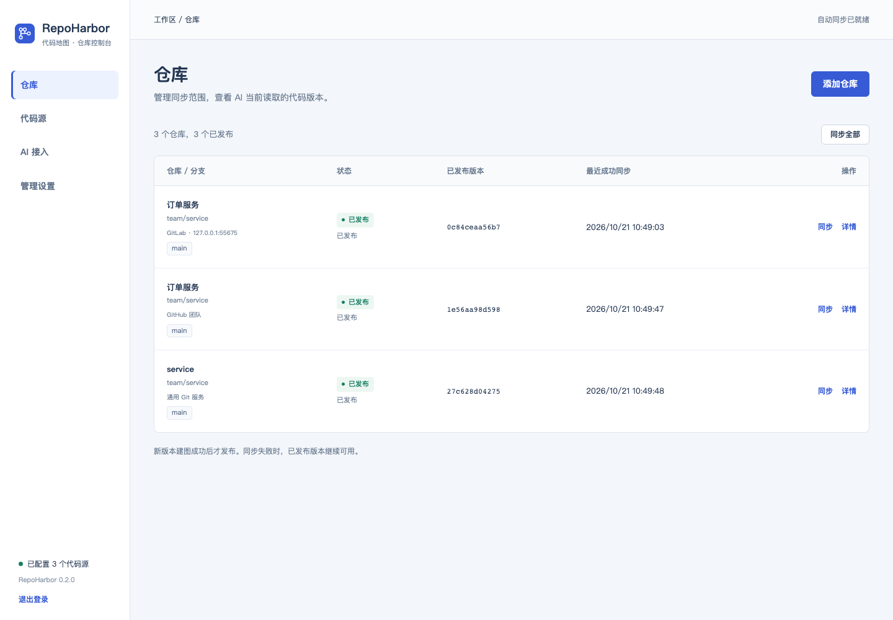
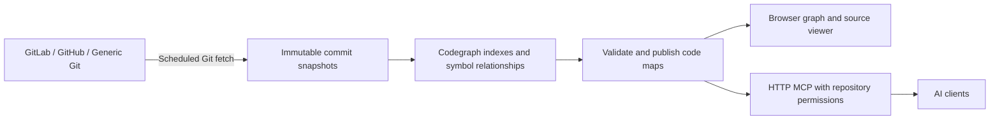
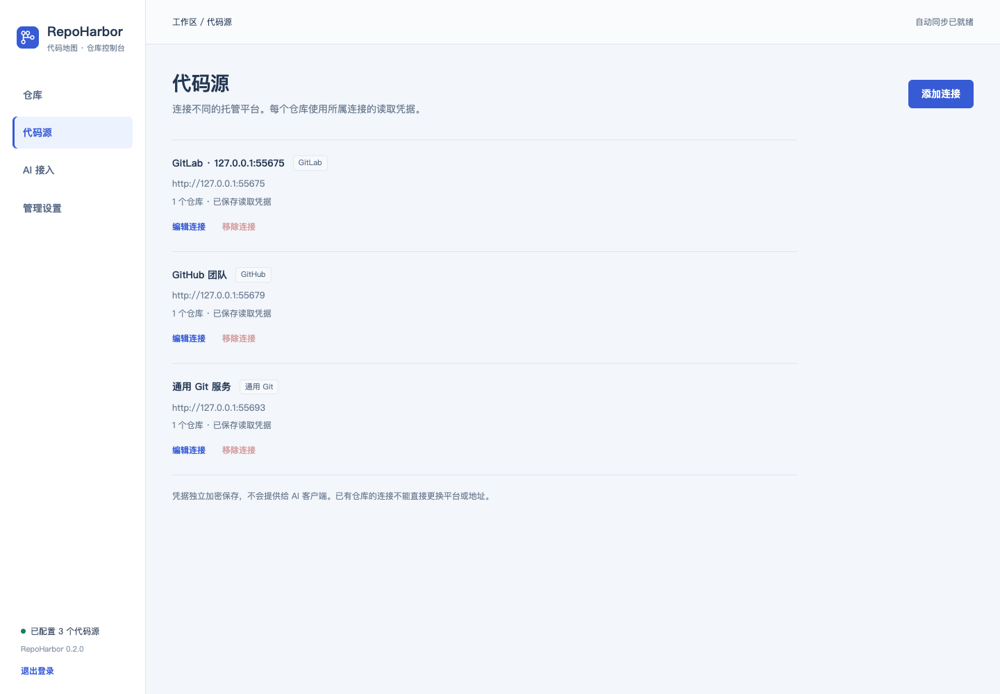
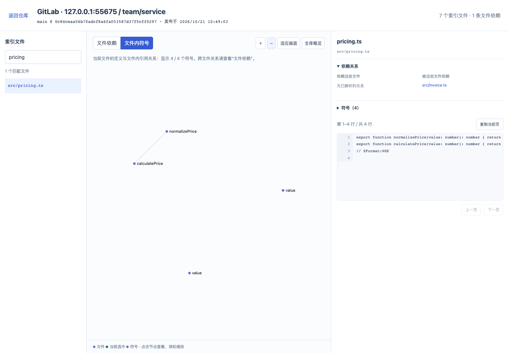
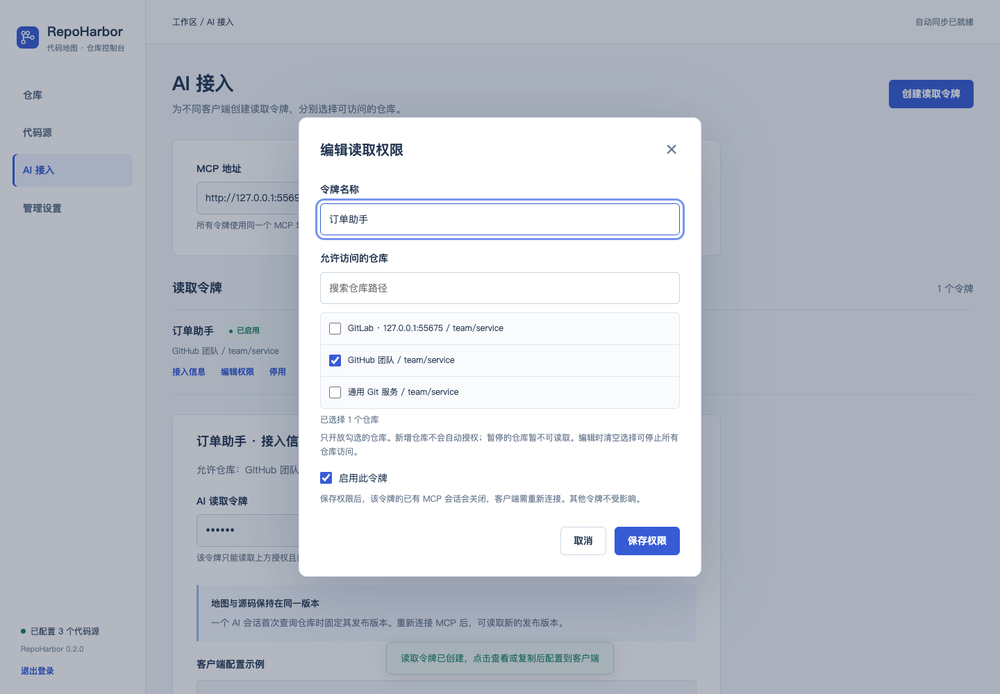

# RepoHarbor

[简体中文](README.md) | **English**

**Self-hosted code maps and MCP access for AI.**

Connect GitLab, GitHub, or a generic HTTP(S) Git server through a web dashboard. RepoHarbor automatically
syncs your code, builds code maps, and lets AI clients find implementations, follow
calls, and read source code from the same commit.

[Quick start](#quick-start) · [Web configuration](#web-configuration) ·
[MCP integration](#mcp-integration) · [Operations](#operations) · [FAQ](#faq) ·
[Security and limitations](#security-and-limitations)



> Current version: **0.2.0**. Docker deployments target **Linux x86_64 / AMD64**.
> The web interface is currently in **Simplified Chinese**; English translations of
> relevant UI labels appear below. Building maps requires no LLM, embeddings,
> Neo4j, or external database. This repository provides source code and packaging
> scripts; the instructions below build the image locally.

## Why RepoHarbor

When an AI client searches and opens files through the hosting API one request at a
time, it repeatedly accesses the remote server and has limited access to call,
reference, and dependency relationships. RepoHarbor prepares that information on
your server before the AI needs it:



AI queries read locally published snapshots. GitLab and GitHub APIs are used for
connection checks, project discovery, and branch listing. Generic Git uses the
standard Git protocol for branch discovery. Failed updates preserve
the previous published version. Within an AI session, maps and source code stay
pinned to the same commit.

## Features

| Feature | Behavior |
| --- | --- |
| Web configuration | Choose GitLab, GitHub, or generic Git, then enter repository URLs and branches without maintaining a configuration file |
| Multiple connections | Up to 32 connections across platforms and servers; each repository uses its own connection and credentials |
| Automatic sync | Check for updates every 15 minutes by default; skip rebuilding when the commit is unchanged, or sync manually |
| Code maps | Use Codegraph 3.0.0 to query symbols, calls, references, file dependencies, and related context |
| Browser viewer | Search files, browse dependencies and symbols within a file, and jump to source lines; assets are served locally |
| Read-only MCP | Streamable HTTP at `/mcp`, with 19 tools for map queries and paginated source reading |
| Repository permissions | Give each AI token an explicit repository list; enforce permissions on repository listing, queries, and source access |
| Consistent versions | Pin a repository to its published commit on first use in a session; reconnect for newer versions |
| Single-container deployment | Node.js, Git, and Codegraph with one persistent volume; no separate model service or database |
| Offline installation | Build an AMD64 installation bundle on a connected machine, then upload, verify, load, and start it on your server |

Parsing and graph queries are provided by [Codegraph](https://github.com/lzehrung/codegraph).
RepoHarbor adds Git synchronization across hosting platforms, snapshot publishing, web administration,
visualization, and remote MCP access with repository permissions. It does not
implement a separate parsing engine.

## Quick start

You need a running Docker Engine, Docker Compose v2, and Git.
**The first source build requires internet access** to download the pinned Node
base image, Debian packages, and npm dependencies. The running service must be
able to reach your configured Git hosting services.

```bash
git clone https://github.com/zzxCoding/repo-harbor.git
cd repo-harbor
./scripts/start.sh
```

The script builds `repo-harbor:0.2.0-amd64`, generates the initial administrator
password, starts the container, and waits for its health check.
Open **`http://your-server:8093`** and sign in with the password printed by the
script. Replace `your-server` with your server's reachable IP address or hostname.
The password is also saved in the deployment directory's `.env`, with `0600`
file permissions.

To choose a different port and bind address on the first deployment:

```bash
PORT=18093 BIND_ADDRESS=127.0.0.1 ./scripts/start.sh
```

An existing `.env` is preserved. For later port changes, edit `.env` and rerun the
startup script. If you change the administrator password in the web interface,
use the new password; the bootstrap password in `.env` does not reset an existing
account. A server running the Docker deployment does not need Node.js or npm
installed separately.

### Fully offline servers

On a machine with internet access, build an installation bundle containing the
image, source code, checksums, and deployment scripts:

```bash
./scripts/build-offline.sh
```

Upload `delivery/repo-harbor-0.2.0-linux-amd64.tar.gz` and its `.sha256` file to your
server, then run:

```bash
sha256sum -c repo-harbor-0.2.0-linux-amd64.tar.gz.sha256
tar -xzf repo-harbor-0.2.0-linux-amd64.tar.gz
cd repo-harbor-0.2.0-linux-amd64
./deploy.sh
```

Installation does not contact npm or a container registry. The build machine
needs Docker and Python 3.9+; an ARM build machine also needs AMD64 emulation.
The detailed [offline installation guide](docs/OFFLINE.md) is currently in
Simplified Chinese.

## Web configuration

### 1. Add a code source connection

Open **Code Sources → Add Connection (代码源 → 添加连接)**. Give the connection a
name, choose the platform, and enter its base URL. A single instance can connect
to multiple GitLab, GitHub, and other Git servers with separately encrypted credentials.

| Platform | Configuration and permissions |
| --- | --- |
| GitLab | Enter the instance's base URL. The token needs `read_api`, `read_repository`, and read access to the selected projects. The Git username usually defaults to `oauth2` |
| GitHub | Enter `https://github.com`. Use a personal access token with the selected repositories and Contents read access. The Git username defaults to `x-access-token` |
| GitHub Enterprise Server | Select GitHub and enter the enterprise instance's base URL. RepoHarbor uses its `/api/v3` endpoint automatically; do not enter the API URL |
| Generic Git | Enter the hosting server's base URL or path prefix. For private repositories, supply the actual Git username and password/token. Read access is checked when adding a specific repository, without a hosting API |

For public GitHub or generic Git repositories, select **No authentication
(无需认证)**. GitLab connections still require a token. GitLab and GitHub support
connection testing before saving. Generic Git performs an actual Git handshake
when you add a repository; saving the connection alone does not verify repository access.

Internal HTTP, HTTPS, custom ports, and private CAs are supported. Supply a CA
certificate in PEM format for enterprise certificates; TLS verification remains
enabled. GitLab instances hosted under a URL subpath are supported. GitHub
organizations may require token approval or SSO authorization. This release uses
personal access tokens and does not provide OAuth login, automatic GitHub App
token refresh, or SSH key authentication.

See [GitLab token scopes](https://docs.gitlab.com/user/profile/personal_access_tokens/)
and [GitHub Contents read permissions](https://docs.github.com/en/rest/branches/branches#list-branches).
The detailed [code source guide](docs/SOURCES.md) is currently in Simplified Chinese.



### 2. Add a repository and branch

Open **Repositories → Add Repository (仓库 → 添加仓库)** and select its code source connection, then enter a specific
repository URL, for example:

```text
https://gitlab.example.internal/team/order-service.git
```

For GitLab and GitHub, `team/order-service` and `git@host:team/order-service.git`
are also accepted. SSH-style addresses identify the project only; synchronization
uses HTTP(S), without SSH keys. Generic Git requires a complete HTTP(S) repository
URL belonging to the selected connection. Each repository uses only that connection's credentials.

Leave the branch blank to use the project's default branch, or enter a target
branch. Saving starts the first sync and full map build automatically. You can
switch branches later in repository details. Each repository configuration tracks
one branch.

### 3. Wait for publication and explore the map

Repository details show stages for fetching code, indexing files, building
dependencies, analyzing symbols, and validation.
**Reaching 100% in the file-indexing stage does not mean the map is published:
symbol analysis and validation must still finish.**

Under **Administration Settings (管理设置)**, you can change the sync interval
(1–1440 minutes, default 15) and the time limit for a complete build
(5–360 minutes, default 120). Initial build time depends on repository size,
language, and CPU resources. No AI connection is required. Logs report progress
throughout the build.

After publication, click **View Map (查看地图)**:



The viewer uses the same port and administrator login as the dashboard. Search
files on the left, explore file dependencies or symbols within the current file
in the middle, and read source code on the right. Clicking a symbol jumps to its
source line. Screenshots use synthetic test repositories.

### 4. Assign repository access to AI clients

Open **AI Integration → Create Read Token (AI 接入 → 创建读取令牌)**. Give the token
a name and select the repositories it may access. For example, an order assistant
can access only the order repository, while a shared-library assistant can access
only shared libraries.



- Clients share the `/mcp` endpoint but use separate Bearer tokens.
- `list_repos` exposes only granted, enabled repositories. Supplying an
  unauthorized repository ID directly does not bypass access checks.
- Newly added repositories are not automatically granted to existing tokens.
  Removing and re-adding the same repository path also requires a new grant.
- Editing permissions, enabling or disabling a token, rotating it, or deleting
  it invalidates that token's sessions. The client must reconnect.
- The administrator password, code source credentials, and AI read token are separate
  credentials. AI clients only need the AI read token.

## MCP integration

Your client must support **Streamable HTTP** and custom request headers.
Configure it with:

| Setting | Value |
| --- | --- |
| Server URL | `http://your-server:8093/mcp`, or the HTTPS URL of your reverse proxy |
| Transport | Streamable HTTP |
| Header | `Authorization: Bearer <AI_READ_TOKEN>` |

Clients that accept an `mcpServers` configuration can use the following example.
Exact fields depend on the client. You can also copy the connection information
generated for the selected token on the AI Integration page.

```json
{
  "mcpServers": {
    "repo-harbor": {
      "url": "http://your-server:8093/mcp",
      "headers": {
        "Authorization": "Bearer <AI_READ_TOKEN>"
      }
    }
  }
}
```

A recommended query sequence:

1. `list_repos`: choose an authorized repository and note its published commit.
2. `search` / `workspace_symbols`: locate implementations using code keywords or
   symbol names.
3. `calls` / `refs` / `file_deps`: follow calls, references, or file dependencies.
4. `get_symbol` / `get_file`: read the actual source before drawing conclusions;
   cite file paths and line numbers.

```json
{"name":"list_repos","arguments":{}}
{"name":"search","arguments":{"repo":"<repo-id>","query":"calculatePrice"}}
{"name":"get_file","arguments":{"repo":"<repo-id>","file":"src/pricing.ts","offset":1,"limit":80}}
```

Prefer the repository ID returned by `list_repos`; the `source` field identifies
its connection. An exact repository path is also accepted when unambiguous.
Identical paths across connections require a repository ID. It may be omitted only when the token can access exactly one
enabled repository. `get_file.offset` uses **1-based** line numbers.
Results include repository metadata with `branch`, `commit`, and `indexedAt`.
Reconnect the session to use a newly published version.
The complete [MCP tool reference and limitations](docs/MCP.md) are currently in
Simplified Chinese.

## Operations

Run these commands from the source deployment directory or an extracted offline
deployment directory:

```bash
docker compose --env-file .env -f compose.yml ps
docker compose --env-file .env -f compose.yml logs --tail=200 -f atlas
docker stats --no-stream "$(docker compose --env-file .env -f compose.yml ps -q atlas)"
```

For compatibility with earlier Code Atlas deployments, the Compose project name
`code-atlas`, internal service name `atlas`, and default volume `code-atlas-data`
are retained. The public project name, MCP server name, and image name use
RepoHarbor. Multiple instances on one host need distinct Compose project names,
ports, and data volumes; see the operations guide.

When upgrading from 0.1.3 or earlier Code Atlas releases, the single GitLab
connection is migrated to multiple connections (storage version=3). Repository
IDs, published maps, the administrator password, and AI token permissions are
preserved. To roll back to 0.1.3 or earlier, restore a pre-upgrade backup to a new
volume; switching only the image is insufficient.

The persistent volume stores configuration, password hashes, encrypted
credentials and their encryption key, Git mirrors, source snapshots, and indexes.
**Back up before upgrading. Do not run `docker compose down -v`.**
Old snapshots are not automatically removed, so monitor disk usage. The
[operations and upgrade guide](docs/OPERATIONS.md), currently in Simplified
Chinese, covers backups, restoration, HTTPS proxies, upgrades, and troubleshooting.

## FAQ

**Do I need a domain name?** No. An internal IP address and port are sufficient,
provided the AI client's host can reach them. Use an internal domain and reverse
proxy when you need a stable URL or HTTPS. A domain name does not connect
otherwise isolated networks.

**Do I need an AI model or API key?** Not for building maps, searching, or reading
source code. The AI client supplies the model. RepoHarbor does not send source
code to an external model API.

**Does it provide natural-language semantic search, including Chinese?** Search
is currently deterministic lexical and symbol search, without embeddings. AI
clients should translate questions into likely class names, method names, field
names, domain keywords, or paths before searching.

**Which programming languages are supported?** Parsing capabilities come from
the pinned Codegraph 3.0.0 release; see the
[upstream documentation at the pinned commit](https://github.com/lzehrung/codegraph/tree/8b55b01a6a529b2b9171b0552c87e470ced5d491/docs).
Call resolution coverage varies by language and framework. Reflection, dynamic
calls, and configuration-based injection are not guaranteed to be fully resolved.

**Why is the first build taking so long?** It analyzes the full repository and
its symbol relationships. Check stage counters, CPU activity, and ongoing logs
to see whether it is progressing. The file-indexing percentage is not overall
build progress. See the operations guide for troubleshooting.

**Why does AI still see an older commit after an update?** Existing sessions
remain pinned to their previous published version. Confirm that the new version
has been published, then reconnect MCP. Reopen browser maps from repository
details to view a newer version as well.

## Security and limitations

- The current service has one administrator, up to 32 code source connections, and multiple
  repositories. It does not provide team accounts, SSO, or automatic inheritance
  of each AI user's hosting-platform permissions. Administrators assign token scopes;
  an instance supports up to 64 AI read tokens.
- MCP is read-only. `refresh_index`, `artifact_build`, and `query_sqlite` are
  disabled. AI clients cannot commit code, switch branches, or trigger builds
  through this service.
- Repository scripts and hooks are not executed. Submodules are not initialized,
  and Git LFS file contents are not downloaded.
- Code source credentials are encrypted at rest, are not filled back into web forms,
  and are excluded from source snapshots and the Codegraph reader environment.
  The persistent volume also contains the encryption key, so backups require
  the same protection as credentials and source code.
- The container runs as a non-root user with a read-only root filesystem,
  dropped Linux capabilities, and no Docker socket.
- Browser graph views display up to 250 nodes to limit rendering cost. This does
  not truncate file search or the complete MCP index. Graph and source evidence
  do not replace business-rule confirmation or runtime validation.
- The supported deployment target is Linux AMD64. Local emulation and synthetic
  repository tests are not performance or framework-coverage guarantees for a
  particular private repository. A health check only confirms process health;
  verify successful map publication and actual queries separately.

## Project structure

```text
src/                 Sync, snapshots, Codegraph reader, MCP, auth, and viewer APIs
public/              Chinese administrator interface and browser code viewer
deploy/              Offline image loading, deployment, backup, and upgrade scripts
scripts/             Source startup, offline packaging, index and browser checks
test/                Synthetic GitLab/Git fixtures and integration tests
docs/                MCP, operations, offline installation, and screenshots
compose.yml          Docker Compose with source builds
Dockerfile           Pinned Node base image and locked npm dependencies
```

For development and testing, see [CONTRIBUTING.md](CONTRIBUTING.md). Implementation
notes are in [DESIGN.md](DESIGN.md), and version history is in
[CHANGELOG.md](CHANGELOG.md). These supporting guides are currently in Simplified
Chinese.

## License and acknowledgments

[MIT](LICENSE). Parsing and graph queries use
[Codegraph](https://github.com/lzehrung/codegraph), remote MCP uses the
[MCP TypeScript SDK](https://github.com/modelcontextprotocol/typescript-sdk), and
the graph viewer uses the Graphology, Sigma.js, and ForceAtlas2 assets bundled
upstream. See [THIRD_PARTY_NOTICES.md](THIRD_PARTY_NOTICES.md) for details.
